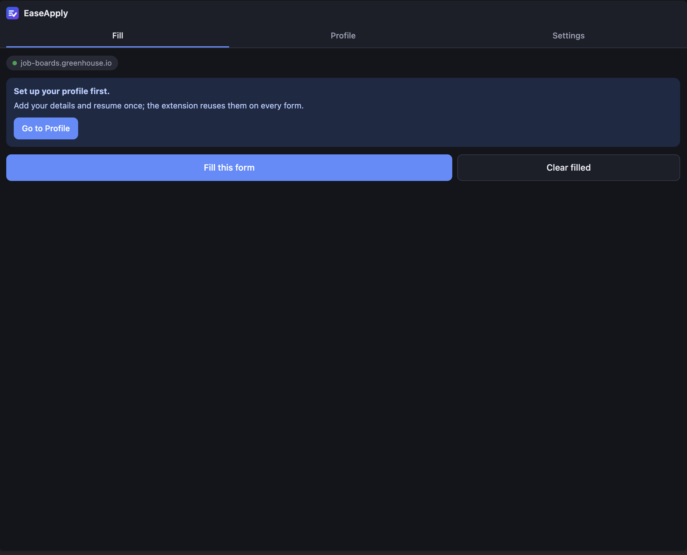
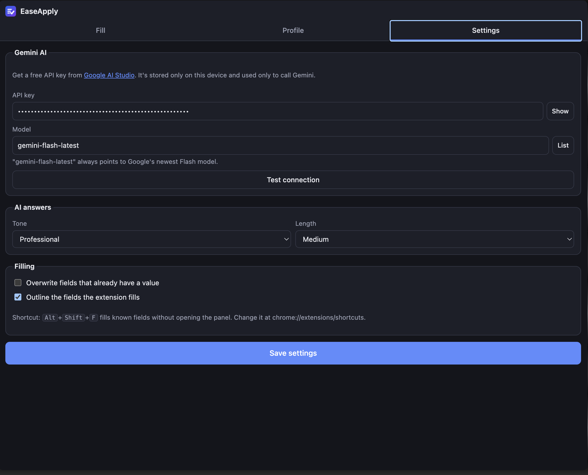
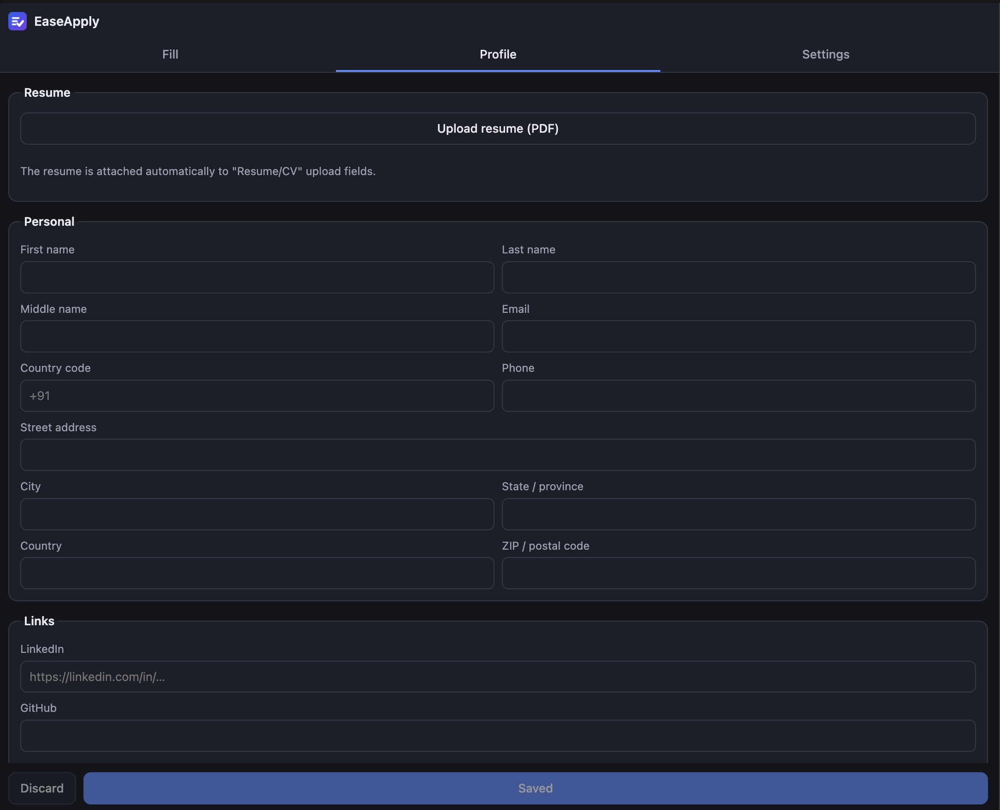
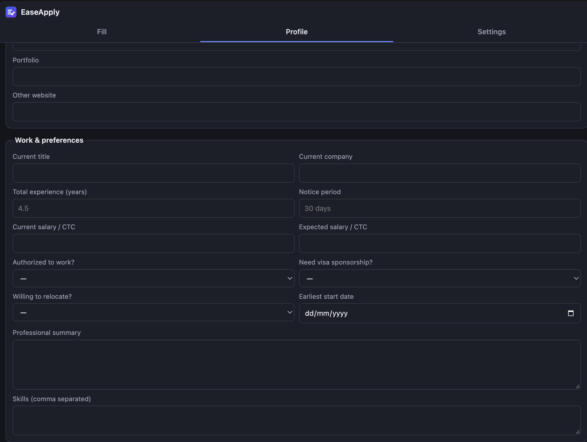
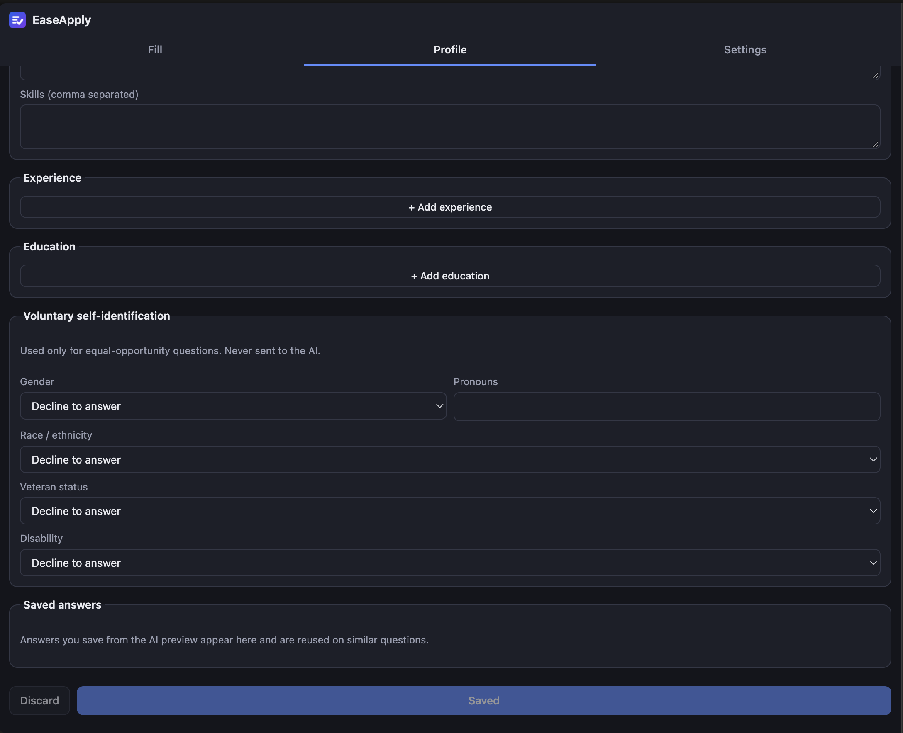

# EaseApply

A Chrome extension (Manifest V3, Angular 21 + Vite) that fills job application forms in one click from your saved profile and resume. For custom questions like "Why are you a good fit?", it drafts answers with Google Gemini (free tier), tailored to the job description on the page. You review and edit the drafts before anything is filled.

## Screenshots

| Fill | Settings |
| --- | --- |
|  |  |

| Profile: personal details | Profile: work & preferences | Profile: experience & self-ID |
| --- | --- | --- |
|  |  |  |

## Setup

```bash
npm install
npm run build        # outputs dist/
```

1. Open `chrome://extensions`, turn on **Developer mode**, click **Load unpacked**, and pick the `dist/` folder.
2. Set up Google sign-in (once, see below), then click the toolbar icon to open the side panel and **Sign in with Google**.
3. **Settings:** paste a free API key from https://aistudio.google.com/apikey and click **Test connection**.
4. **Profile:** upload your resume (PDF), click **Import profile from resume (AI)**, review the details, then **Save**.

### Google sign-in

The side panel asks you to sign in with a Google account. Sign-in uses `chrome.identity.launchWebAuthFlow`, so it needs an OAuth client of your own:

1. Load the extension once and copy its ID from `chrome://extensions`. The ID of an unpacked extension stays the same as long as the `dist/` folder doesn't move.
2. In the [Google Cloud console](https://console.cloud.google.com/apis/credentials), configure the OAuth consent screen (External; add yourself as a test user), then **Create credentials → OAuth client ID → Web application**.
3. Under **Authorized redirect URIs**, add `https://<extension-id>.chromiumapp.org/`.
4. Put the client ID in `.env.local` and rebuild:

   ```bash
   VITE_GOOGLE_CLIENT_ID=1234567890-abc.apps.googleusercontent.com
   ```

Only the `openid email profile` scopes are requested. The access token is used once to read your name, email and picture, and is never stored.

## Using it

- **Profile sets:** keep a separate profile, resume and saved answers for each kind of role, for example "Software Engineer" and "Data Analyst". On the Profile tab, click **+ New set** (optionally copying the current set), then change what differs for that role. Pick the set to use from **Fill as** on the Fill tab; the keyboard shortcut uses the same set.
- **Fill this form:** fills every field it recognizes from your profile, saved answers and resume. Unrecognized questions are listed underneath.
- **Draft answers with AI:** one Gemini call drafts answers for the unrecognized questions, using your resume and the job description. Edit them, untick any you don't want, then click **Fill selected**. Tick "Save this answer" to reuse an answer on similar questions later without calling the AI.
- **Clear filled:** restores every field the extension filled (in all frames) to what it held before. Fields you typed yourself are left alone.
- **Alt+Shift+F:** fills known fields without opening the panel.

Filled fields are outlined green (profile), blue (saved answer) or purple (AI).

## Privacy

Your profile sets, resumes and API key stay in `chrome.storage.local` on this device, kept separately for each Google account that signs in; signing out leaves them in place for next time. The only network calls go to Google sign-in (name, email and picture) and Google's Gemini API. Equal-opportunity answers (gender, race, veteran, disability), consent checkboxes and file fields other than the resume are never sent to the AI and never guessed. The extension never submits a form.

## Development

```bash
npm run watch        # rebuild on change, then click reload at chrome://extensions
npm test             # Vitest + jsdom unit tests
npm run typecheck    # strict Angular template type check
npm run serve:test   # serves test-pages/ at http://localhost:8080/sample-form.html
```

| Path | What it does |
| --- | --- |
| `src/content/` | Content script (IIFE, runs in every frame): scanner, label resolver, matcher, filler, clear registry, job-description extraction |
| `src/background/` | Service worker: Gemini provider (`ai/`), quick-fill shortcut |
| `src/app/` | Angular side panel: sign-in, Fill, Profile (with profile sets), Settings |
| `src/shared/` | Profile model, per-account storage, field rules, option matching, frame runner |

To add another AI provider (Groq, OpenRouter, Ollama), implement `AiProvider` in `src/background/ai/ai-provider.ts`.
